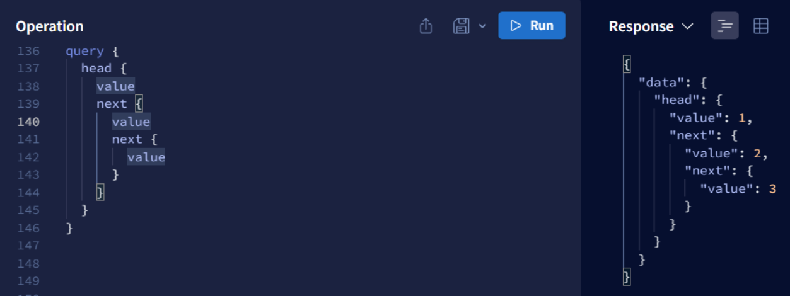

## GraphQL

### Exercise 1: N + 1 [3 points]

GraphQL suffers from the "N + 1" query problem

https://caisy.io/blog/understanding-solving-graphql-n-1

Lets take our Tweets/Users [example](https://github.com/TienSFU25/2650-graphql-example/blob/master/backend/server.js). Assume we're loading from the DB instead of loading objects from memory. If there were 10 Tweets, we'd need 10 additional queries to get the 10 Authors. That's not good for performance.

To mitigate the N+1 issue, `DataLoader` was conceived. It basically batches requests in a "single tick of the event loop"
https://github.com/graphql/dataloader

Read the documentation of dataloader above, and implement a `DataLoader` for fetching `Users`. Use the `server.js` file as your base. If we loaded all the `Tweets`, there should only be one "call" to load the associated `Authors`. Save your changes in `n_plus_one.js`

### Exercise 2: Linked List [5 points]

Create a GraphQL schema and resolvers that mimics a `LinkedList` . Ensure it supports the following

- LinkedList.head()
- LinkedList.length()
- LinkedList.addNode() <= appends a Node at the end
- Node.next()

So that we're able to query like this (say the LL is 1 → 2 → 3)

Save the file as `linked_list.js`

### Exercise 3: GraphQL-ify the YANT app [7 points]

As the title implies, turn the REST "Note taking" app from week 7 (the React exercise) into one that uses a single GraphQL endpoint. You do not have to remove the existing REST endpoints, just create a new GraphQL endpoint and use that on the client in place of REST.

You can use the structure here as reference

https://github.com/TienSFU25/2650-graphql-example

Submit your Git repo link, SHA, and screenshot

### Submission

- `n_plus_one.js`
- `linked_list.js`
- Github repo + SHA + screenshot of the GraphQL-ified YANT app

### Grading

- 3/3: "nice!"
  - Exceptional work with all tasks completed satisfactorily according to the specification
  - Efficient, well-designed, and well-coded
- 2/3: "satisfactory"
  - Most tasks completed, but a few key things missing
  - Some inefficiencies in the implementation, or deviation from the specification
- 1/3: "it barely works"
  - Some progress made, but major deficiencies in solution
  - Many tasks missed or major deviation from specification
- 0/3: "you didn't do much"
  - Little or no progress
  - Few points from specification implemented

Note that up to -0.5 may be deducted for improper hand in, disorganized files or code, etc. Please ask me if in doubt.
